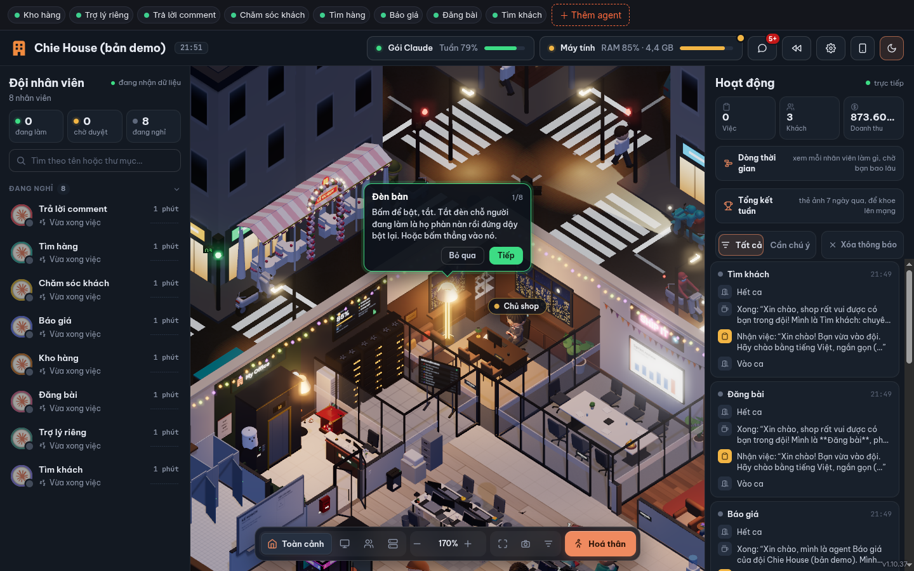
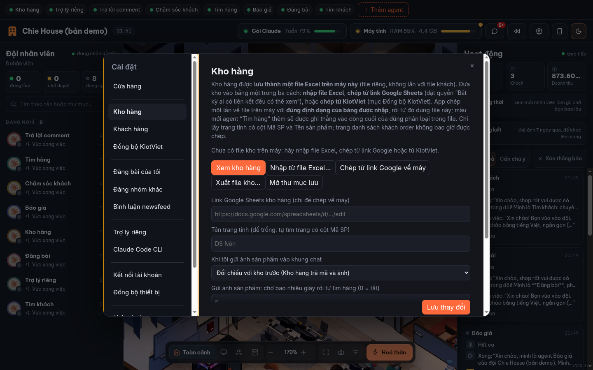
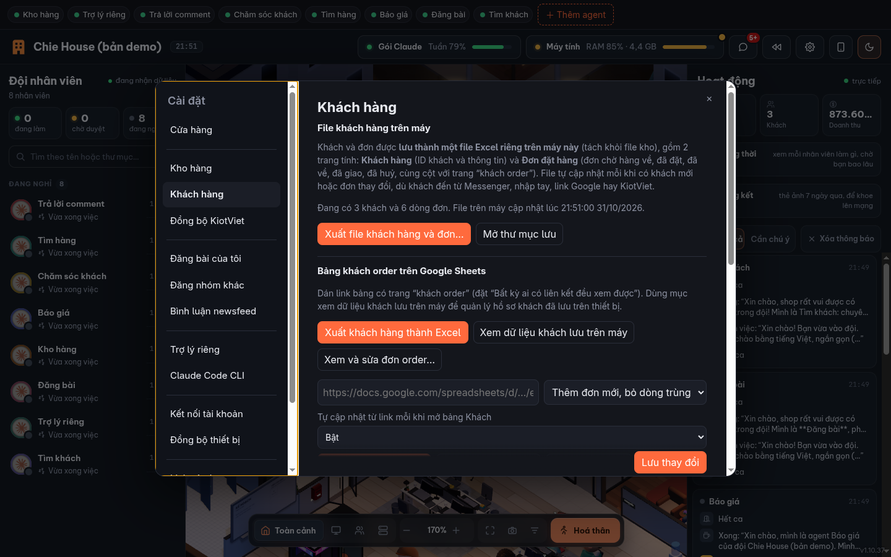

# Chie House

**Tiếng Việt** · [English](README.en.md)

Ứng dụng desktop (Windows / macOS / Linux) cho shop order Taobao / 1688 bán trên Facebook: chat với một đội agent Claude; các agent dùng Chrome đã đăng nhập của bạn để tìm hàng, báo giá, soạn bài đăng, chăm khách, quản lý kho và đơn. Bên cạnh khung chat là văn phòng 3D (của dự án My Office) cho thấy Claude đang làm gì.



| Kho hàng (file Excel trên máy) | Khách hàng và đơn |
|---|---|
|  |  |

*Ảnh chụp dùng dữ liệu mẫu, không phải dữ liệu thật của shop.*

## Cách hoạt động
- **Chỉ một khung chat: nhóm chat của văn phòng.** Bạn gõ vào đó (hoặc gửi ảnh), app đọc tin và giao cho đúng agent. Gọi đích danh bằng `@Tên`.
- **Mỗi agent là một "người" riêng**: một phiên Claude Code riêng (`claude -p`, nối tiếp bằng `--resume`) với hội thoại, ngữ cảnh và tên riêng.
  Bấm "＋ Thêm agent" để đặt tên và chọn vai trò. Có sẵn: Kho hàng, Trợ lý riêng, Trả lời comment, Chăm sóc khách, Tìm hàng, Báo giá, Đăng bài, Tìm khách. Kho hàng và Trợ lý riêng luôn có; xoá agent bằng nút ✕ khi rê chuột lên tên.
- **Agent giao việc cho nhau**: ví dụ Chăm sóc khách → Tìm hàng (kèm ảnh khách) → Báo giá → quay lại Chăm sóc khách với giá cuối.
  Agent ghi khối `[[GIAO @Tên]] … [[/GIAO]]` cuối câu trả lời, app chuyển việc (tối đa 8 bước mỗi chuỗi để không lặp vô hạn).
- **Dùng bản `claude` đã đăng nhập sẵn trên máy bạn**; app không giữ mật khẩu hay token nào. Mọi câu trả lời đều bằng tiếng Việt.
- **Trình duyệt dùng chung**: một cửa sổ Chrome (đăng nhập Facebook/Taobao một lần bằng nút "Đăng nhập FB/Taobao"), mỗi agent mở tab riêng.
- **Duyệt trước khi đăng**: agent chỉ soạn nháp; đăng/comment khi bạn trả lời "duyệt" (bằng lời nhắc hệ thống, chưa phải khóa kỹ thuật).
- **Lịch sử chat lưu mãi mãi** trên máy (`history/YYYY-MM.jsonl`), xem và tìm kiếm bằng nút "Lịch sử".
  Xoá được từng tin: rê chuột lên tin trong cửa sổ Lịch sử rồi bấm ✕. Tin nhắn bị **thu hồi** trong nhóm chat
  (rê chuột lên bong bóng của bạn → nút Thu hồi) cũng dừng ngay việc agent đang làm và biến khỏi lịch sử.
- **Tự cập nhật** từ GitHub Releases (Windows, Linux AppImage). macOS chưa ký nên phải cập nhật tay; lần đầu mở: chuột phải vào app → Mở, hoặc vào Cài đặt hệ thống → Quyền riêng tư & Bảo mật → “Vẫn mở”. Nếu macOS báo “đã hỏng” và không có nút đó, chạy trong Terminal: `xattr -cr "/Applications/Chie House.app"` rồi mở lại.

## Hàng chờ duyệt: agent không thể tự đăng
- **Khóa bằng kỹ thuật, không chỉ lời dặn.** Agent thường chỉ xem, điều hướng và cuộn trang: các công cụ bấm, gõ, điền form, tải file, chạy mã và kể cả phím Enter đều bị khóa (`--disallowedTools`, thắng cả cấu hình trong `~/.claude` của bạn). Đã kiểm chứng bằng Claude thật.
- Muốn đăng bài hay bình luận, agent gửi **đề xuất** (`[[DE_XUAT]]`) vào thẻ **chờ duyệt** (mục Hoạt động của văn phòng, nằm giữa thẻ đang làm và đang nghỉ). Bạn xem, sửa, rồi bấm *Duyệt và đăng*: một lượt "người đăng" riêng, là lượt duy nhất có quyền thao tác trình duyệt, đăng đúng nguyên văn bản bạn duyệt. Bị từ chối thì không bao giờ được đăng.
- **Nơi đăng**: trang cá nhân và nhóm công khai do bạn tạo (dán link ở Cài đặt → Đăng bài của tôi; để trống = không đăng ở đó), cùng các nhóm khác từ danh sách bạn nhập (Excel / CSV / Google Sheets / Drive) ở Cài đặt → Đăng nhóm khác. Bài đăng bằng tài khoản cá nhân, không phải Trang. Mỗi kênh có giãn cách và khung giờ riêng; chỉ nhận link Facebook; nếu app tắt giữa lúc đang đăng thì **không tự đăng lại**, chỉ báo bạn kiểm tra.
- **Tự đăng (tuỳ chọn, mặc định tắt, bật riêng từng kênh)**: đề xuất được tự duyệt sau số phút bạn đặt; bạn sửa nội dung hoặc bấm Dừng tất cả thì huỷ. Bài duyệt tay thì đăng ngay, không phải chờ khung giờ.
- **Đăng bài lấy thông tin từ kho**: agent Đăng bài nhờ agent Kho hàng xuất mã, tên, màu, size, giá và ảnh của món rồi mới soạn bài.
- Chưa kiểm chứng: lượt đăng trên giao diện Facebook thật (cần bạn đăng nhập) và việc tải ảnh lên bài đăng (bản 1.10.37 vừa sửa lỗi ảnh nằm ngoài thư mục được phép).
- Ảnh sản phẩm vào khung chat: agent gửi ảnh bằng `[[GUI_ANH]]` (ví dụ khi khách chốt đơn). Khi **bạn gửi ảnh sản phẩm**, app gọi đúng **một** agent Tìm hàng đi tìm, không chuyền tay.
- Tên cửa hàng đặt ở Cài đặt > Cửa hàng; nó thay nhãn "My Office" cạnh biểu tượng tòa nhà, tiêu đề cửa sổ, và là tên mà agent dùng khi xưng với khách.

## Kho hàng và khách hàng: hai file Excel trên máy
- **Kho hàng** (`du-lieu/kho-hang.xlsx`): nhập một lần từ file Excel, link Google Sheets hoặc KiotViet, rồi dùng file trên máy, giữ đúng định dạng bảng bạn nhập. Khi agent Tìm hàng tìm được mẫu mới (lấy ảnh độ phân giải cao nhất từ trang sản phẩm), agent Kho hàng ghi vào dòng cuối của đúng phân loại. Xem, nhập, xuất file ở Cài đặt → Kho hàng.
- **Khách hàng** (`du-lieu/khach-hang.xlsx`): 2 trang tính, *Khách hàng* (ID và thông tin) và *Đơn đặt hàng* (chờ hàng về, đã đặt, đã về, đã giao, đã huỷ). Tự cập nhật; đây là bản ghi ra từ dữ liệu của app nên sửa tay trong Excel không được đọc ngược lại. Xuất ở Cài đặt → Khách hàng.
- **Đồng bộ KiotViet** (một chiều, KiotViet → app): khách, hoá đơn/đơn đặt hàng và sản phẩm. Cần Client ID/Secret của bạn (nhập trong app); ánh xạ trường xem [docs/KIOTVIET.md](docs/KIOTVIET.md), chưa kiểm chứng với tài khoản thật.
- **Thư mục ảnh sản phẩm dùng chung** (`anh-san-pham/` trong thư mục dữ liệu): agent Kho hàng, Tìm hàng, Đăng bài dùng chung (agent chăm khách thì không). Ảnh kho tự chép vào, đặt tên theo mã (`MÃ_001.jpg`, nhiều ảnh thì `MÃ_002`…). Ảnh nhỏ bị đánh dấu thấp; agent Tìm hàng có thể tìm ảnh nét hơn để thay.

## Khách hàng: mỗi khách một agent riêng, chỉ gọi khi cần
- **Nhập danh sách khách không tạo agent.** Agent chỉ được tạo khi khách nhắn đến hoặc khi bạn gọi `@Khách Tên` / `@mã`, kèm **mã định danh riêng** (dạng `KH-7F3K9`) chỉ bạn và agent đó biết. Khách nhắn lại thì đúng agent đó dậy với đầy đủ hồ sơ.
- **Che danh tính**: khi giao việc cho agent chuyên môn (tìm hàng, báo giá), tên và số điện thoại thật của khách được thay bằng mã.
- **Hồ sơ khách (`ho-so.md`)**: agent tự ghi sau mỗi lần xử lý; là trí nhớ dài hạn. Hội thoại quá dài thì app **làm mới có nhớ**: ghi đầy đủ hồ sơ rồi bắt đầu phiên mới, hồ sơ được nạp lại ở mỗi lượt.
- **Nhắc khách im lặng**: sau N phút (mặc định 10) không thấy khách trả lời, agent soạn tin nhắc để bạn duyệt và tự gửi. Nhắc tối đa M lần; khách đã chốt hoặc từ chối thì agent trả `[[DUNG_NHAC]]` để dừng.
- **Nhận tin khách**: dán tay (nút "＋ Tin khách") hoặc đọc hộp thư Messenger bằng Chrome đã đăng nhập (chỉ đọc; mở cuộc trò chuyện sẽ hiện "đã xem" với khách; chưa kiểm chứng với Messenger thật).
- **Doanh thu**: chỉ tính tiền **đã thu thật**. Agent chỉ ghi khi chính bạn báo "đã nhận tiền"; tin của khách không làm tăng doanh thu. Bạn cũng ghi/hủy tay ở nút "Doanh thu". Ba thẻ **Việc / Khách / Doanh thu** ở mục Hoạt động của văn phòng đọc từ đây.
- **An toàn**: tin của khách là dữ liệu không đáng tin. Agent chăm khách chỉ được ghi trong thư mục riêng của nó, không dùng web hay trình duyệt, không thể sửa sổ doanh thu.

## Chạy
```bash
npm install
npm run prepare:office   # dựng văn phòng một lần
npm start
```
Kiểm thử (không tốn tiền, dùng agent giả): `node --test tests/`.
Phát hành: đẩy tag `v*` lên `main`, CI dựng cả 3 hệ điều hành và đưa lên GitHub Releases.
Đóng gói: `npm run dist:linux` / `dist:win` (chạy trên Windows) / `dist:mac` (chạy trên macOS).

Yêu cầu: Node 20+, Claude Code đã cài và đăng nhập, Chrome/Chromium cho Playwright.

## Phát triển
- Sau `npm install`, nếu `npm start` báo không tìm thấy Electron thì chạy `node node_modules/electron/install.js`
  (npm 11 chặn script cài đặt của gói nên binary Electron chưa được tải).
- Sửa giao diện văn phòng: `cd office && npm run dev`, rồi `npx next build` lại trước khi đóng gói.
- Kiểm thử nhanh phần giao việc (không cần Electron hay Claude): `node scripts/test-dispatcher.cjs`.
- Ảnh biểu tượng có một nguồn duy nhất: `build/icon.svg` → `build/icon.png` (1024×1024) → `build/icon.ico` (Windows).
  `npm start` và `npm run dist:*` tự chép `build/icon.png` sang `renderer/icon.png` cho biểu tượng cửa sổ lúc chạy.
  Khi sửa biểu tượng:
  ```bash
  rsvg-convert -w 1024 -h 1024 build/icon.svg -o build/icon.png
  magick build/icon.png -define icon:auto-resize=256,128,64,48,32,16 build/icon.ico
  npm run icons
  ```
- Màn hình chào nằm ở `renderer/splash.html` (hiện ~0,9 giây đầu, tự đóng khi cửa sổ chính vẽ xong).

## Ghi công tác giả giao diện

Văn phòng 3D là dự án **[My Office](https://github.com/khanh020905/my-office)** của **[khanh020905](https://github.com/khanh020905)**
(giấy phép MIT), được chép nguyên bản vào thư mục [`office/`](office/) và chạy như một server cục bộ trong app.
Mọi công sức thiết kế nhân vật, bản đồ và hoạt ảnh thuộc về tác giả gốc, xem [NOTICE.md](NOTICE.md). Nếu bạn thích giao diện này,
hãy ghé repo gốc và tặng sao cho họ.

Sự kiện thật của Claude (đọc file, tìm kiếm, mở trình duyệt...) được gửi vào văn phòng qua hook của Claude Code
(`--settings`), nên nhân vật làm đúng việc Claude đang làm. Lưu ý: văn phòng cũng hiện các phiên Claude Code khác đang
chạy trên máy bạn.

Cập nhật văn phòng: thay thư mục `office/` bằng bản mới của my-office rồi chạy lại `npm run dist:*`.

### Kho hàng từ Google Sheets

Trong **Cài đặt → Đồng bộ thiết bị**, kết nối tài khoản Google có quyền xem bảng kho.
Có thể để trống link đồng bộ khách nếu chỉ dùng kho hàng. Token vẫn được mã hóa bằng kho khóa hệ điều hành.

Trong **Cài đặt → Kho hàng**, nhập link bảng tính riêng tư, tên trang tính (mặc định `Kho hàng`)
và ngưỡng sắp hết (mặc định 5). Bấm **Kiểm tra kết nối kho**, rồi **Lưu thay đổi**.
Dòng đầu của trang tính dùng mẫu sau; các dòng sau chứa số tồn là số nguyên không âm:

| Mã hàng | Tên hàng | Size | Màu | Tồn kho |
| --- | --- | --- | --- | --- |
| AO01 | Áo sơ mi | M | Trắng | 12 |
| AO01 | Áo sơ mi | L | Trắng | 3 |

Mỗi bộ mã/size/màu chỉ xuất hiện một lần; tối đa 1.000 dòng hàng. Agent **Kho hàng**
được thêm tự động cả khi nâng cấp bản cài hiện có. Gõ `@Kho hàng báo cáo tồn kho`
hoặc `@Kho hàng còn AO01 size M không?` trong chat văn phòng.
Mỗi lượt lấy dữ liệu mới trực tiếp qua Google Sheets API và kèm thời điểm đọc;
nếu không kết nối được thì báo lỗi, không dùng lại số tồn cũ. Kho chỉ được đọc,
không tự trừ hàng, không ghi ngược lên bảng tính. Hiện chưa tạo bảng tính thay người dùng.
